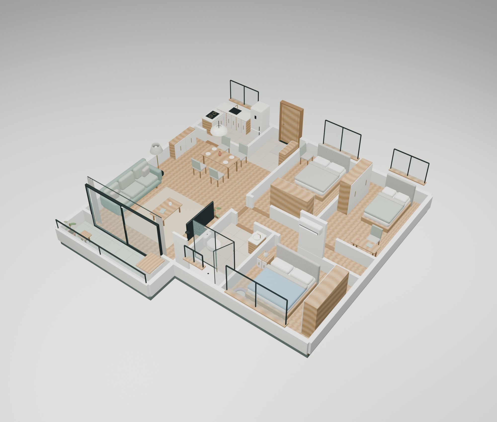

# 房屋模型 · 协作者入口

这里集中存放已交付的 **两房一厅** 和 **三房两厅**。下载 GLB 即可加载模型；修改几何或材质时使用对应 Blender 工程。

| 户型 | GLB 模型 | Blender 工程 | 效果与布局 |
| --- | --- | --- | --- |
| [两房一厅](./generic-two-bedroom/README.md) | [下载 两房一厅.glb](./generic-two-bedroom/两房一厅.glb?raw=1) | [下载 .blend](./generic-two-bedroom/future-home-generic-two-bedroom-v0.1.blend?raw=1) | [效果图](./generic-two-bedroom/screenshots/default-blender.png) · [俯视图](./generic-two-bedroom/screenshots/plan-blender.png) |
| [三房两厅](./generic-three-bedroom/README.md) | [下载 三房两厅.glb](./generic-three-bedroom/三房两厅.glb?raw=1) | [下载 .blend](./generic-three-bedroom/future-home-generic-three-bedroom-v0.1.blend?raw=1) | [效果图](./generic-three-bedroom/screenshots/default-blender.png) · [俯视图](./generic-three-bedroom/screenshots/plan-blender.png) |

## 名称对应

| 中文文件名 | 稳定模板标识 | 原 GLB 文件名 |
| --- | --- | --- |
| `两房一厅.glb` | `generic_two_bedroom` | `future-home-generic-two-bedroom-v0.1.glb` |
| `三房两厅.glb` | `generic_three_bedroom` | `future-home-generic-three-bedroom-v0.1.glb` |

此次重命名没有改变模型内容、房间或设备标识。程序使用的路径和哈希统一见 [catalog.json](./catalog.json)，不要仅凭中文显示名猜测模板标识。

GLB 和 Blender 工程都已包含贴图。两套均延续浅木、低墙剖切风格；原有小公寓与大户型仍在 `sandbox-prototype/house-modeling/`。

两套资产来自 `codex/generic-house-models` 的 `4bf23c8e8e92aeb1f588b59892c133fae6d82c31`，自 Homie 0.0.6 接入手机端户型菜单，与一房一厅分别加载各自模型；未启用旧大户型或四房选项。两房包含 8 个房间区域、三房包含 10 个，两套各有 9 个设备或检查点。GLB、Blender 工程、截图、QA 和原校验清单保持交付内容。

## 手机端接入

- 每个模型目录新增 `mobile-object-map.json`，从 GLB 提取真实对象、房间、热点和相机目标节点，另行配置双语名称及手机相机偏移。运行 `node scripts/extract-model-maps.mjs` 生成；加 `--check` 仅检查当前文件是否匹配。
- `src/features/sandbox-runtime/templates.ts` 统一登记菜单、模型路径、映射、房间与设备列表、可关联的家具类型。Vite 使用静态 `?url` 导入，模型资源随 Android APK 打包，不从 GitHub 或 CDN 在线下载。
- “全屋检查”显示已添加设备；“沙盒演示”提供新户型的场景设备。四个公共对象沿用本地离家流程，额外五个对象仅展示只读演示数据，均不是实际设备状态或联网控制。
- 同名对象在不同模板下分别关联家具和保存本页模拟进度。切户型保留各自计划与读数，退出沙盒或切换语言后重开；本机家具和显式关联继续保留。

状态样例、关联存储键和生命周期详见 [手机沙盒交接](../docs/sandbox-handoff.md)。未来模型替换时同时更新映射与目录，不能只更换中文标题或复用其他户型的对象表。

## 下载与校验

- 在线：点击表格中的“下载”链接保存原始文件。不要使用浏览器“另存网页”保存 GitHub 文件页面。
- 已克隆仓库：更新到包含本次模型交付的分支后，在 `models/` 内获取文件。
- 核对完整性：在仓库根目录运行 `python models/verify_models.py`，只需要 Python 标准库。
- 对接或二次编辑前，先阅读各户型的说明；两房一厅的客餐厅为同一区域，三房两厅的客厅和餐厅独立。

| 两房一厅 | 三房两厅 |
| --- | --- |
|  |  |
