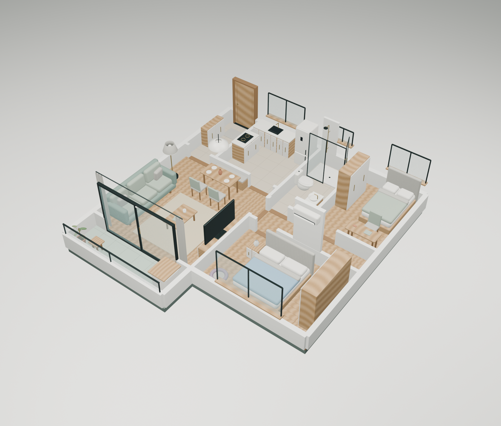

# 房屋模型 · 协作者入口

这里集中存放已交付的 **两房一厅** 和 **三房两厅**。下载 GLB 即可加载模型；修改几何或材质时使用对应 Blender 工程。

| 户型 | GLB 模型 | Blender 工程 | 效果与布局 |
| --- | --- | --- | --- |
| [两房一厅](./generic-two-bedroom/README.md) | [下载 两房一厅.glb](./generic-two-bedroom/两房一厅.glb?raw=1) | [下载 .blend](./generic-two-bedroom/future-home-generic-two-bedroom-v0.1.blend?raw=1) | [效果图](./generic-two-bedroom/screenshots/default-blender.png) · [俯视图](./generic-two-bedroom/screenshots/plan-blender.png) |
| [三房两厅](./generic-three-bedroom/README.md) | [下载 三房两厅.glb](./generic-three-bedroom/三房两厅.glb?raw=1) | [下载 .blend](./generic-three-bedroom/future-home-generic-three-bedroom-v0.1.blend?raw=1) | [效果图](./generic-three-bedroom/screenshots/default-blender.png) · [俯视图](./generic-three-bedroom/screenshots/plan-blender.png) |

## 名称对应

| 中文文件名 | 稳定模板标识 | 原 GLB 文件名 |
| --- | --- | --- |
| `两房一厅.glb` | `generic_two_bedroom` | `future-home-generic-two-bedroom-v0.1.glb` |
| `三房两厅.glb` | `generic_three_bedroom` | `future-home-generic-three-bedroom-v0.1.glb` |

此次重命名没有改变模型内容、房间或设备标识。程序使用的路径和哈希统一见 [catalog.json](./catalog.json)，不要仅凭中文显示名猜测模板标识。

GLB 和 Blender 工程都已包含贴图。两套均延续浅木、低墙剖切风格；原有小公寓与大户型仍在 `sandbox-prototype/house-modeling/`。新模型尚未接入 App 户型选择，本目录只交付建模资产。

## 下载与校验

- 在线：点击表格中的“下载”链接保存原始文件。不要使用浏览器“另存网页”保存 GitHub 文件页面。
- 已克隆仓库：更新到包含本次模型交付的分支后，在 `models/` 内获取文件。
- 核对完整性：在仓库根目录运行 `python models/verify_models.py`，只需要 Python 标准库。
- 对接或二次编辑前，先阅读各户型的说明；两房一厅的客餐厅为同一区域，三房两厅的客厅和餐厅独立。

| 两房一厅 | 三房两厅 |
| --- | --- |
|  |  |
