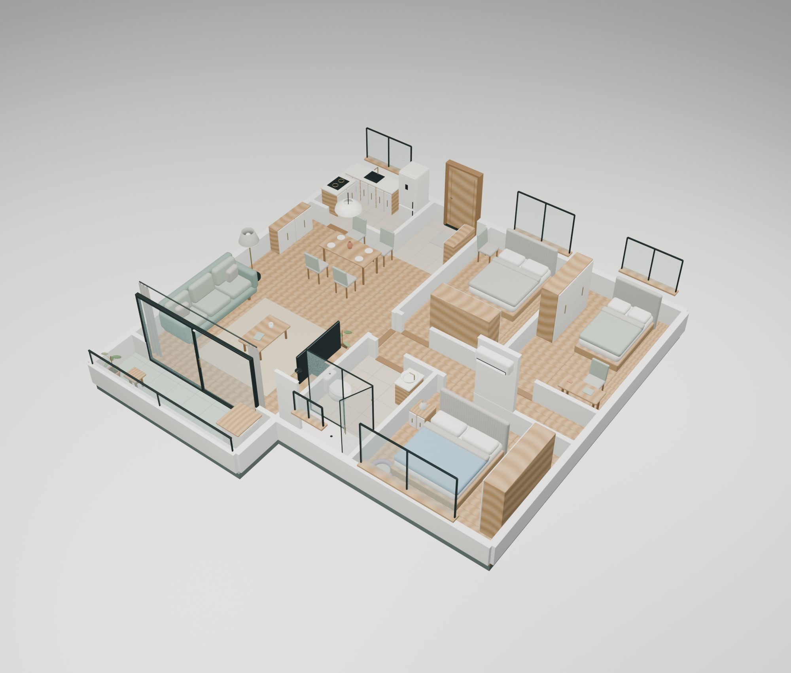

# 三房两厅

主卧、客卧、次卧，独立客厅与餐厅，厨房、一个卫生间、玄关、卧室走廊和生活阳台。床宽分别为 1.8、1.5、1.2 米。

| 用途 | 文件 |
| --- | --- |
| 加载或集成模型 | [下载 三房两厅.glb](./三房两厅.glb?raw=1) |
| 在 Blender 中编辑 | [下载 Blender 工程](./future-home-generic-three-bedroom-v0.1.blend?raw=1) |
| 全屋效果图 | [斜俯视图](./screenshots/default-blender.png) |
| 户型布局 | [俯视图](./screenshots/plan-blender.png) |
| 文件完整性 | [SHA256 校验清单](./SHA256SUMS.txt) |

GLB 已使用中文文件名 **`三房两厅.glb`**。模板标识保持 `generic_three_bedroom`，版本为 `0.1`，与改名前的模型内容一致。Blender 工程保留原文件名，贴图已打包；GLB 材质与贴图也已嵌入，可独立加载。

模型采用米制，glTF 坐标为 X 东、Y 上、Z 南。10 个房间区域，9 个独立设备或检查点，保留 `shared_id`、房间归属、热点与相机目标节点。区域轴线面积约 112.28㎡，阳台全计；不是建筑面积或实测套内面积。

原资产来自 `codex/generic-house-models` 的 `4bf23c8e8e92aeb1f588b59892c133fae6d82c31`，现已接入 Homie 0.0.6 的“三房两厅”菜单。手机适配使用本目录新增的 [mobile-object-map.json](./mobile-object-map.json)，从 GLB 真实节点提取映射并附加手机相机参数；原始 GLB、Blender 工程、截图、QA 和校验清单不变。需要修改几何时打开 `.blend`；独立使用模型时直接取 `.glb`。

“全屋检查”与“沙盒演示”仍分开。玄关门、阳台门磁、客厅灯和主卧空调接入本地离家模拟；其余五个设备只展示演示读数，没有真实设备接口或网络控制。家具关联按 `generic_three_bedroom` 独立存储，不继承一房或两房同名对象的关联；页面内切换户型保留本轮任务，退出沙盒或切换语言后重开。详细接口见 [沙盒交接说明](../../docs/sandbox-handoff.md)。

几何与回导记录见 [QA](./qa/)。在仓库根目录运行 `python models/verify_models.py`，可核对两个模型的文件名、SHA256、GLB 结构、模板节点和嵌入资源。

[返回全部模型](../README.md)
